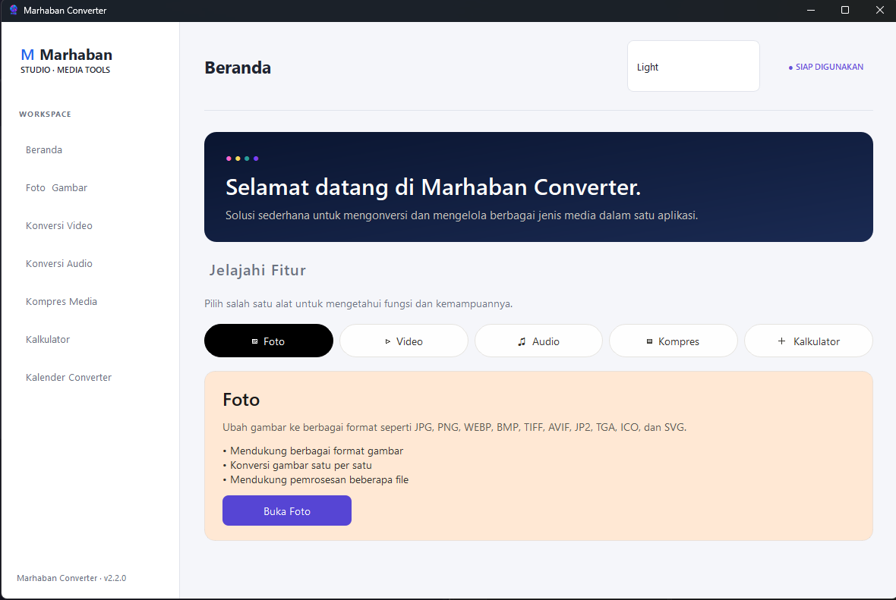
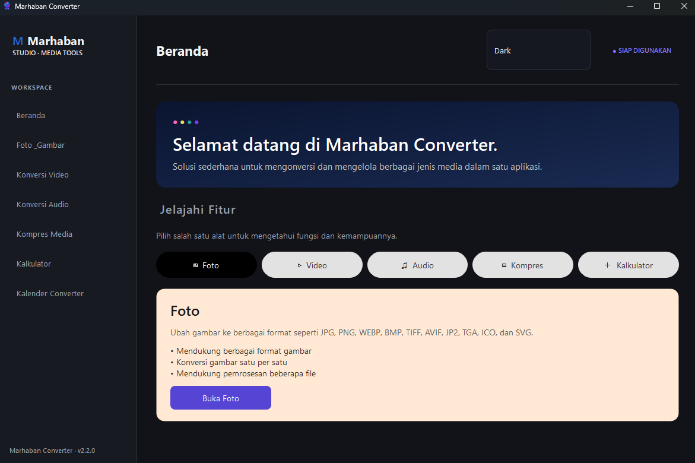
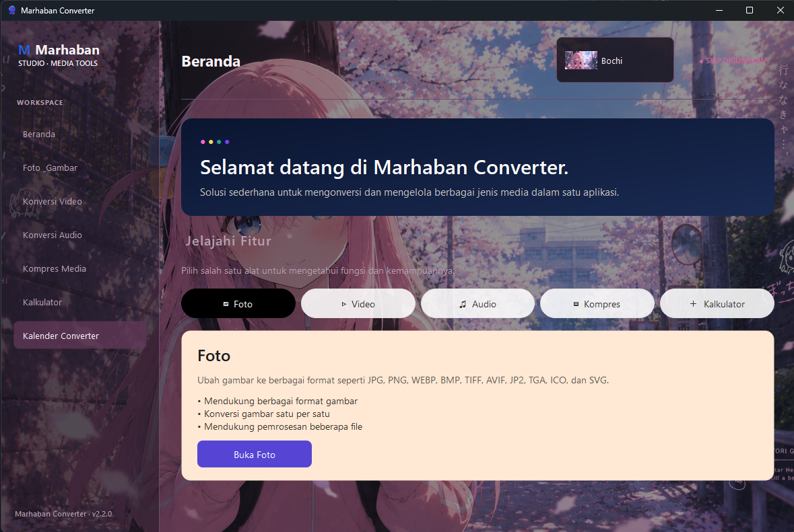
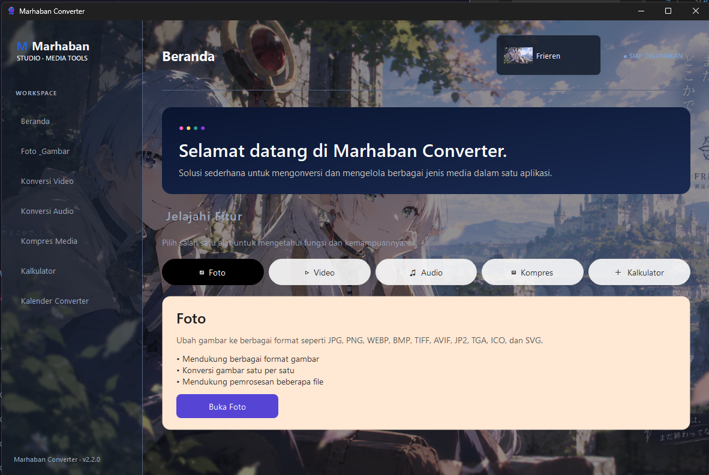
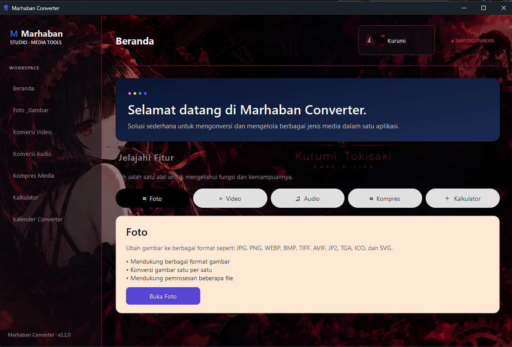
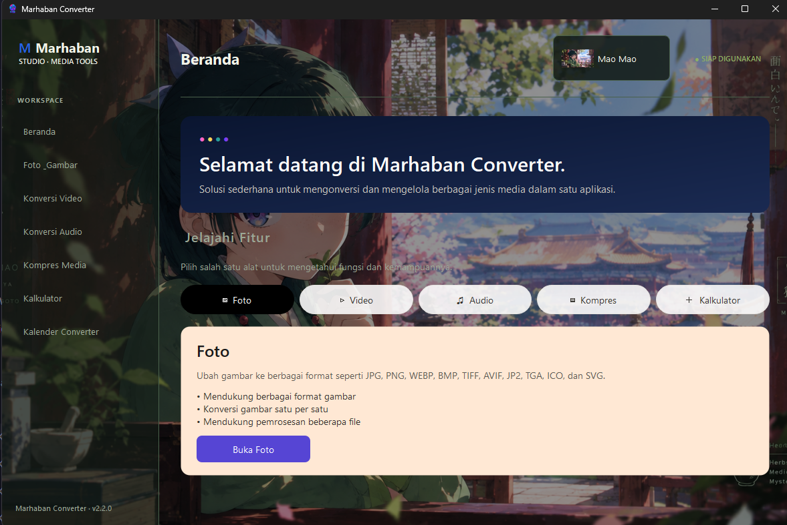
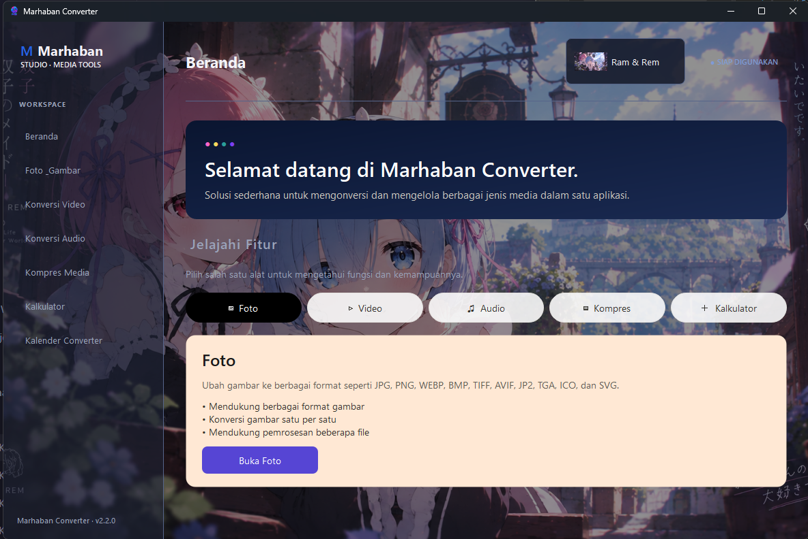

<p align="center">
  
</p>

<h1 align="center">Marhaban Converter</h1>

<p align="center">
  <strong>Aplikasi Desktop Konversi Media dan Utilitas Modern untuk Windows</strong>
</p>

<p align="center">
  Konversi, kompres, dan kelola berkas media, lakukan perhitungan ilmiah, serta konversi tanggal Hijriah dan Masehi melalui aplikasi desktop modern.
</p>

<p align="center">
  <a href="https://github.com/kuliahIMC/converter/releases">
    
  </a>
  <a href="https://github.com/kuliahIMC/converter/releases">
    
  </a>
  
  
  
  
  
  
</p>

---

## ✨ Tentang Marhaban Converter

**Marhaban Converter** adalah aplikasi desktop native untuk Windows yang dikembangkan oleh **Marhaban Studio**. Aplikasi ini dirancang untuk membantu pengguna mengonversi dan mengolah berkas media, melakukan perhitungan ilmiah, serta mengonversi tanggal Hijriah dan Masehi.

Dibangun menggunakan C++17 dan Qt 6, Marhaban Converter mengutamakan pengalaman penggunaan desktop yang modern, antarmuka yang bersih, arsitektur modular, serta kemampuan pemrosesan yang efisien.

Teknologi yang digunakan:

- **C++17** — Bahasa pemrograman untuk logika dan fungsionalitas utama aplikasi.
- **Qt 6** — Kerangka kerja antarmuka desktop.
- **FFmpeg** — Mesin pemrosesan audio dan video.
- **FFprobe** — Pemeriksaan media dan pengambilan metadata.
- **CMake** — Konfigurasi dan pengelolaan proses pembangunan aplikasi.
- **MinGW** — Kompilator C++ untuk Windows.
- **Inno Setup** — Pembuatan installer Windows.

---


## 🖥️ Tampilan Aplikasi

Marhaban Converter menyediakan beberapa pilihan tema yang dapat disesuaikan dengan preferensi pengguna.

### Light Theme


### Dark Theme


### Bochi Theme


### Frieren Theme


### Kurumi Theme


### Mao Mao Theme


### Ram & Rem Theme


## 🚀 Fitur Aplikasi

### 🖼️ Pengolah Gambar dan Foto

Kelola dan konversi berkas gambar melalui halaman khusus.

- Konversi format gambar.
- Pemrosesan dan kompresi gambar.
- Mendukung berbagai format gambar.
- Pemilihan berkas dan pengaturan lokasi hasil konversi.
- Pengaturan folder keluaran yang dapat disesuaikan.
- Penyimpanan otomatis pengaturan folder keluaran.

### 🎬 Konversi Video

Konversi berkas video menggunakan mesin pemrosesan FFmpeg.

- Konversi format video.
- Pemrosesan aliran media.
- Pemeriksaan media menggunakan FFprobe.
- Proses konversi di latar belakang.
- Pengaturan folder keluaran yang dapat disesuaikan.
- Penyimpanan otomatis pengaturan folder keluaran.

### 🎵 Konversi Audio

Proses dan konversi berkas audio ke berbagai format yang didukung.

- Konversi format audio.
- Pemrosesan aliran audio.
- Pengodean menggunakan FFmpeg.
- Pemrosesan di latar belakang.

### 📦 Kompresi Media

Mengurangi ukuran berkas media melalui fitur kompresi khusus.

- Kompresi gambar.
- Alur kerja kompresi media.
- Pengaturan opsi pemrosesan.

### 🧮 Kalkulator Ilmiah

Kalkulator bawaan yang mendukung operasi aritmetika dasar dan perhitungan ilmiah.

- Operasi aritmetika dasar.
- Fungsi trigonometri.
- Fungsi logaritma.
- Operasi eksponen dan perpangkatan.
- Mode derajat dan radian.
- Konstanta matematika.

### 📅 Konverter Kalender Hijriah dan Masehi

Mengonversi tanggal antara sistem kalender Hijriah dan kalender Masehi.

- Konversi tanggal Hijriah ke Masehi.
- Konversi tanggal Masehi ke Hijriah.
- Dukungan nama-nama bulan Hijriah.
- Perhitungan kalender Hijriah tabular.
- Perhitungan kalender sipil.
- Menampilkan hasil konversi dalam kedua sistem kalender.

**Catatan:** Hasil perhitungan tanggal Hijriah dapat berbeda dengan tanggal yang ditetapkan berdasarkan rukyatul hilal atau keputusan otoritas keagamaan setempat.

### 🎨 Tema Tampilan

Sesuaikan tampilan aplikasi menggunakan berbagai pilihan tema.

| Tema | Deskripsi |
| :--- | :--- |
| Light | Tampilan terang dan bersih |
| Dark | Tampilan gelap |
| Bochi | Tema terinspirasi karakter |
| Frieren | Tema terinspirasi karakter |
| Kurumi | Tema terinspirasi karakter |
| Mao Mao | Tema terinspirasi karakter |
| Ram & Rem | Tema terinspirasi karakter |

---

## 🧰 Teknologi yang Digunakan

| Teknologi | Kegunaan |
| :--- | :--- |
| C++17 | Pengembangan inti aplikasi |
| Qt 6.12 | Kerangka kerja aplikasi desktop |
| Qt Widgets | Komponen antarmuka pengguna |
| CMake | Sistem pembangunan aplikasi |
| MinGW | Kompilator C++ |
| FFmpeg 9.0.1 | Pemrosesan audio dan video |
| FFprobe | Informasi dan pemeriksaan media |
| PowerShell | Otomatisasi pengembangan |
| Inno Setup 7 | Pembuatan installer Windows |

---

## 🏗️ Arsitektur Proyek

Marhaban Converter menggunakan struktur proyek modular untuk memisahkan komponen antarmuka pengguna, layanan aplikasi, utilitas, dan pemrosesan di latar belakang.

```text
marhaban-app/
│
├── .vscode/
│
├── build/
│
├── external/
│   └── ffmpeg/
│
├── installer/
│   ├── payload/
│   ├── output/
│   └── MarhabanConverter.iss
│
├── resources/
│   ├── icons/
│   ├── images/
│   └── styles/
│
├── src/
│   ├── services/
│   ├── ui/
│   ├── utils/
│   ├── workers/
│   │
│   ├── app_context.cpp
│   ├── app_context.h
│   └── main.cpp
│
├── tests/
│
├── CMakeLists.txt
├── run.ps1
└── README.md
```

### Penjelasan Arsitektur

- **UI Layer** — Mengelola jendela aplikasi, navigasi, dan interaksi pengguna.
- **Services Layer** — Menangani konversi media, kompresi, konversi kalender, pengaturan, dan layanan aplikasi.
- **Workers Layer** — Menangani tugas pemrosesan di latar belakang.
- **Utils Layer** — Menyediakan fungsi pendukung bersama dan pengelolaan lokasi aplikasi.
- **Resources** — Menyimpan ikon, gambar, dan aset visual.
- **Tests** — Menyimpan pengujian aplikasi, termasuk pengujian konversi kalender.

---

## 💻 Persyaratan Sistem

### Persyaratan Penggunaan

| Persyaratan | Spesifikasi |
| :--- | :--- |
| Sistem Operasi | Windows 10 / Windows 11 |
| Arsitektur | 64-bit (x64) |
| RAM | Minimum yang disarankan 4 GB |
| Penyimpanan | Menyesuaikan aplikasi dan berkas media |
| Dependensi | Qt, MinGW Runtime, dan FFmpeg yang disertakan |

### Lingkungan Pengembangan

- Windows 10 atau Windows 11.
- Kompilator yang mendukung C++17.
- Qt 6.12.
- CMake.
- MinGW yang kompatibel dengan Qt.
- FFmpeg dan FFprobe.
- Inno Setup 7.

---

## 📥 Instalasi

### Menggunakan Installer Windows

1. Buka halaman [Rilis Marhaban Converter](https://github.com/kuliahIMC/converter/releases).
2. Unduh installer Marhaban Converter versi terbaru.
3. Jalankan berkas installer.
4. Ikuti petunjuk instalasi yang ditampilkan.
5. Jalankan Marhaban Converter melalui Start Menu atau pintasan Desktop.

> Installer Windows sudah menyertakan dependensi runtime aplikasi dan komponen FFmpeg yang diperlukan.

---

## 🛠️ Membangun dari Source Code

### 1. Mengunduh Repository

```bash
git clone https://github.com/kuliahIMC/converter.git
cd converter
```

### 2. Mengonfigurasi Proyek

```powershell
cmake -S . -B build -G "MinGW Makefiles"
```

Pastikan CMake dapat menemukan lokasi instalasi Qt dan kompilator MinGW yang kompatibel.

### 3. Membangun Aplikasi

```powershell
cmake --build build --config Release
```

### 4. Menjalankan Aplikasi

```powershell
.\build\MarhabanConverter.exe
```

Sebagai alternatif, gunakan skrip PowerShell yang telah disediakan:

```powershell
.\run.ps1
```

---

## 📦 Membuat Installer Windows

Marhaban Converter menggunakan **Inno Setup 7** untuk mengemas aplikasi menjadi installer Windows.

Proses pengemasan mencakup:

- Berkas executable aplikasi.
- Pustaka runtime Qt.
- Pustaka runtime MinGW.
- Plugin platform dan gambar Qt.
- Sumber daya aplikasi.
- Berkas executable FFmpeg dan FFprobe.
- Pustaka bersama FFmpeg yang diperlukan.

Kompilasi installer menggunakan perintah berikut:

```powershell
& "C:\Program Files\Inno Setup 7\ISCC.exe" ".\installer\MarhabanConverter.iss"
```

Installer yang dihasilkan akan tersimpan di:

```text
installer/output/
```

---

## ⚖️ Lisensi dan Pemberitahuan Pihak Ketiga

Marhaban Converter merupakan perangkat lunak berpemilik (*proprietary software*) yang dikembangkan oleh **Marhaban Studio**.

Proyek ini menggunakan beberapa teknologi dan pustaka pihak ketiga, termasuk:

- **Qt** — Komponen yang didistribusikan tunduk pada ketentuan lisensi Qt yang berlaku.
- **FFmpeg** — Paket FFmpeg yang disertakan menggunakan konfigurasi GPL dan pustaka pihak ketiga tambahan. Distribusinya harus mematuhi ketentuan lisensi yang berlaku.
- **MinGW** — Pustaka runtime tunduk pada lisensi masing-masing.

Pemberitahuan lisensi pihak ketiga dan penyediaan kode sumber yang diwajibkan harus dipenuhi sesuai ketentuan lisensi terkait.

Aplikasi Marhaban Converter sendiri tidak menggunakan lisensi yang sama dengan seluruh dependensi pihak ketiganya.

---

## 🏢 Pengembang

<p align="center">
  <strong>MARHABAN STUDIO</strong>
</p>

<p align="center">
  Pengembangan Aplikasi Desktop
</p>

<p align="center">
  Membangun perangkat lunak yang bermanfaat dengan teknologi modern.
</p>

---

<p align="center">
  <strong>Marhaban Converter</strong><br>
  <sub>Dibangun dengan C++ · Qt 6 · FFmpeg</sub>
</p>
